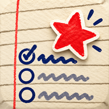
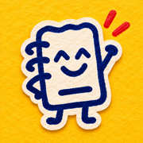

  🛠️ Side projects I build for myself, on evenings and weekends. Nothing
  commissioned — just things I wanted to exist.

  
    
  
  

    Side project · 2026 — present · Coming soon
    <h2 class="project-title">Taskward</h2>
    
A calm to-do list where every list is a paper card on your desk: Today in front,
      the rest in a wooden holder behind it. Tasks are written the way you'd say them, and the
      day and the reminder set themselves. No account or ads, everything kept in your own iCloud.

    

      iOS 17+
      macOS 14+
      Flutter
      BLoC
      freezed
      Drift
      CloudKit
    

    <a class="project-link" href="https://alobanov.github.io/taskward/" target="_blank" rel="noopener">Visit Taskward →</a>
  

  
    
  
  

    Side project · 2026 — present · On the App Store
    <h2 class="project-title">Boop</h2>
    
A diary where every day becomes a doodle: a few lines, a mood and the habits
      ticked off turn into a small drawing, and the days build into a canvas of the year.
      No accounts, ads or tracking of what is written.

    

      iOS 17+
      iPadOS 17+
      Flutter
      BLoC
      freezed
      Drift
      WidgetKit
    

    <a class="project-link" href="https://alobanov.github.io/getboop/" target="_blank" rel="noopener">Visit Boop →</a>
  

